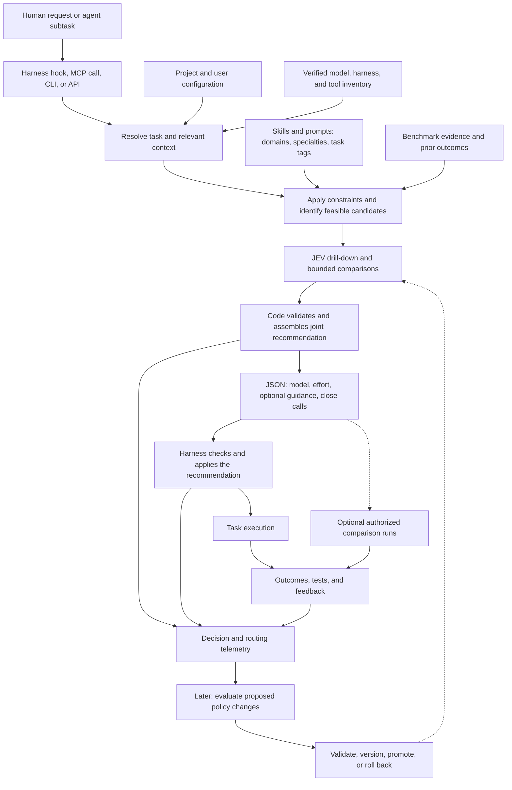

# JEV Drill: plain-English product and behavior specification

Version: 0.1 — draft for refinement  
Date: 2026-09-27  
Implementation baseline: Python, Pydantic, SQLite, and language-independent JSON interfaces

## 1. Purpose

JEV Drill helps a human-facing assistant or agent choose how to perform a task. Before execution, it recommends a **model, a supported effort setting, and any helpful skill or prompt guidance**, using the request, project context, available capabilities, user preferences, and evaluation evidence.

These are parts of one decision. A skill might make an affordable model sufficient, or a difficult task might warrant both specialized guidance and a stronger model. A simple task might need no skill at all. A no-skill decision still includes a model and effort recommendation whenever a compatible execution configuration exists.

“Best” means the most suitable feasible combination under the user's quality, cost, latency, and other constraints. The router must not present an uncertain estimate as proof of optimality.

JEV Drill returns control to the calling harness. The harness launches or delegates the work, supplies guidance, applies permissions, and reports what actually happened.

This document specifies intended behavior. It does not assert that the router, database, schemas, or integrations have already been implemented. It separates first-release requirements from later capabilities and decisions still to be made.

## 2. Terms

| Term | Meaning |
|---|---|
| JEV | TypeSafe's model for answering structured questions about supplied state |
| JEV Drill | The product described here: catalog, context handling, routing, handoff, and evaluation |
| Harness | The application or runtime that runs an assistant, manages tools, and executes work |
| Guidance | Skill instructions, reusable prompts, or workflow instructions supplied for a task |
| Resource | A cataloged skill, prompt, command, workflow, or supporting reference |
| Configuration | A model, effort setting, guidance revisions, tools, and execution path considered together |
| Effort | The selected model's native reasoning setting or budget, where supported |
| Policy | The versioned rules and parameters used to select configurations |
| State | Context assembled for a particular JEV request; distinct from the full persistent database |
| Outcome | Evidence about execution, quality, cost, latency, or user satisfaction after a decision |

## 3. System flow



An incompatible environment or a material missing fact produces an explicit structured status instead of an unusable execution recommendation. Recommendations requiring setup are kept separate from configurations that can run now.

## 4. First-release scope

The first usable release must include joint model/effort/guidance selection, a local catalog, project context, capability and dependency checks, a structured handoff, and decision/outcome recording.

It must support one working harness integration end to end. Its common contract must be usable from MCP, a CLI, or an API without requiring integrations to be written in Python. Additional adapters can follow.

The first release must expose close calls and experiment proposals and accept comparison results produced by an external runner. An integrated two- or three-way experiment runner and automatic policy learning are later capabilities.

The initial router selects inspected resource revisions. Automatic rewriting, distillation, broad skill composition, and self-modifying routing policies are outside the first release. It may combine a small number of existing, compatible resources where the policy permits and records their order.

## 5. When routing happens

Routing may happen before an initial human request, before a delegated subtask, at a meaningful change in the task, or after a failure suggesting the current configuration is unsuitable.

It should not automatically repeat before every token generation or tool call. The harness supplies the trigger, current task identity, relevant context changes, and active guidance so the router can reuse a still-valid decision.

Before a model is launched, the harness may apply the entire recommendation. During an active session, it may only be able to inject guidance or launch a new delegate. The adapter must declare these capabilities; unsupported model switching must never be reported as completed.

Routing calls carry a bypass marker or equivalent mechanism so routing the router cannot create recursion. Requests, decisions, and execution attempts have separate stable identifiers so retries do not duplicate launches or telemetry.

## 6. Inputs and context gathering

The input includes the current task, intended output, relevant session summary, project and directory scope, execution target, active resources, user constraints, and the harness's capabilities. It also identifies the inventory, configuration, catalog, and policy versions being used.

The raw task is preserved in the task record when retention policy permits. A concise routing representation is stored separately, with its origin and transformation recorded. Summarization must not silently discard binding requirements.

Context gathering should start with supplied information, configured paths, and inexpensive local metadata. Additional inspection is justified when it can change the recommendation. Reading an entire repository or conversation is not a prerequisite for every route.

For example, “review the login form” may require the framework, changed files, accessibility requirements, and available browser tools. It does not ordinarily require unrelated accounting records from the same project.

The router may ask for a missing fact when it materially changes feasibility or suitability. It should not ask about information already available from authorized inspection. A missing jurisdiction must not be guessed from a user's language or apparent location.

If a missing fact prevents checking a hard constraint or a required resource's applicability, return `needs_context` unless a verified alternative can satisfy the task without that fact. If uncertainty only affects which feasible configuration is likely to perform better, a ready recommendation using a disclosed conservative default is allowed. Uncertainty about quality does not waive uncertainty about permission or feasibility.

For images, audio, and other attachments, preserve authorized references and modality requirements. Send only a suitable, permitted textual representation to a text-only routing model. Do not claim the router inspected visual or audio content merely because it received a filename or a summary.

## 7. Project, user, and machine configuration

Use a project-local `.jevdrill/` directory for shared project context and optional local overrides. Begin with a small `project.yaml`; split configuration as it grows rather than requiring many files at setup.

| Location or file | Intended contents |
|---|---|
| `.jevdrill/project.yaml` | Project identity, facts, requirements, resource references, and instruction-file references |
| Optional `.jevdrill/routing.yaml` | Shared routing preferences and project constraints |
| Optional `.jevdrill/local.yaml` | Personal project overrides, excluded from version control |
| User-level configuration | Personal defaults, access profiles, subscription declarations, and privacy/retention settings |
| Ignored machine cache | Discovered tools, access checks, model availability, and freshness metadata |

Relevant project facts include programming languages, frameworks, formatting conventions, target platforms, audience, jurisdictions, research methods, citation style, and desired output conventions. The format must also work for non-code projects.

Every fact distinguishes explicit configuration from automatic discovery and records its scope and source. Detected facts do not overwrite explicit facts. Incorrect or stale explicit facts can be flagged for correction.

Reference authoritative files such as `AGENTS.md`, formatter settings, package manifests, and local command definitions. Avoid copying rules that would become inconsistent with their originals. Changes to referenced files invalidate the relevant cached context.

Support narrower directory scopes, such as a Python service inside a TypeScript monorepo. Explain which setting won and why. The project boundary must be explicit; discovery must not walk into unrelated parent directories.

Preference defaults resolve from product defaults through user defaults, project preferences, narrower directory preferences, personal project overrides, and the current request. Mandatory constraints and governing instructions are evaluated separately under the harness's authority rules. A preference override cannot grant access, disable a higher-priority restriction, or make an unavailable capability real. Unresolvable mandatory conflicts produce an explicit conflict result.

Configuration is declarative. Reading it does not execute commands or install anything. Secrets are kept in the user's credential system; configuration may store credential references and access status, never credential values.

## 8. Environment and capability inventory

The inventory describes what a particular user can actually run on a particular execution target.

| Inventory area | Required information |
|---|---|
| Models | Provider, model ID/version, modalities, context limits, tool support, output constraints, native effort options |
| Access routes | API, subscription-backed harness, local endpoint, or other supported route; credential reference and access status |
| Harnesses | Installed version and support for switching models, configuring effort, tools, delegation, injection, and reporting outcomes |
| Subscriptions and budgets | Declared access, observed quota or rate-limit state where available, spending limits, and allowed fallbacks |
| Local inference | Runtime, model artifact/version, quantization when relevant, hardware fit, endpoint health, and tested configuration |
| Tools and dependencies | Executables, packages, MCP capabilities, services, permissions, versions, and execution scope |
| Operational constraints | Offline requirements, privacy boundaries, allowed providers, installation policy, and resource limits |

An active subscription does not prove that a model is available through every harness or that API access is included. A local model download does not prove that it fits in memory or runs with the required context and tools. Record the actual access route rather than inferring interchangeability.

Availability states must distinguish configured, verified available, unavailable, stale, and unknown. Each check records its method, timestamp, target, and useful non-secret evidence. A verified status is bounded by what was checked; a model-list response is not proof that every request will succeed.

A ready recommendation requires its necessary capabilities to be verified usable under the configured check and freshness policy. Configured-only, stale, or unknown capabilities must be refreshed before they become ready candidates. If that cannot be done, select a verified alternative or return a non-ready result; do not defer an unresolved prerequisite under a ready label. A later transient failure does not rewrite the historical decision: the harness records the failed check and any newly verified fallback before execution.

Use supported metadata and harmless checks before asking the user to resolve access. Checks that incur meaningful cost, start workloads, or change state follow the user's existing authorization and budget policy.

Before execution, the harness rechecks transient conditions as needed. If access fails, use only an allowed fallback and record the substitution. Do not silently switch a subscription user to a paid API or send a private task to a newly available external provider.

JEV itself is an external capability to inventory. A local-only request may prohibit a cloud routing call even when the eventual execution model is local. In that case, use a permitted deterministic/cached route or report the limitation without transmitting the task.

## 9. Resource catalog and descriptions

Catalog public, organization, project, and personal skills, prompts, commands, workflows, and supporting references. A collection directory is a discovery source; it is not itself evidence that every linked item is an admitted skill.

Each resource needs:

- A stable identity, display name, resource type, and scope.
- A source URL or local path, source aliases, revision or content hash, retrieval/check times, and publisher attribution.
- A concise description of its purpose, useful situations, outputs, boundaries, and requirements.
- Domain memberships, specialties, task tags, and applicable language, framework, jurisdiction, modality, or audience facets.
- Required and optional dependencies, permissions, supporting files, and compatibility limits.
- License/reuse information, review status, evaluation evidence, and any known conflicts or superseding resource.

Descriptions should initially target about 80–150 words, with shorter entries where sufficient. They must reflect inspected contents. Publisher claims, our interpretation, and measured effectiveness remain distinguishable. A useful description must help distinguish neighboring resources, not merely repeat their category names.

For example, an accessibility skill description should say whether it supports interactive testing or only code review, what findings it produces, and what evidence it cannot establish from screenshots alone.

Advisory guidance and tool-operation instructions remain distinct resource types or attributes. Both can be useful, but they help in different ways. A command is an executable resource with explicit inputs and side effects, not text that the router may execute simply because it was retrieved.

Local resources follow the same identity and dependency rules. Track renamed paths and exact revisions. User-written guidance can be explicitly enabled without pretending it has independent validation.

Discovery, review, admission, and successful evaluation are separate states. Default automatic injection must use resources admitted under the applicable policy. Rejected, quarantined, and unresolved resources remain searchable for catalog management but cannot silently enter ordinary routing. Experimental use of unvalidated resources must be explicit and recorded.

## 10. Categories, task tags, and cross-domain retrieval

Start from the current 32 domains and 258 specialties, rather than treating those counts as permanent limits. Add domains or specialties when newly discovered material exposes a meaningful gap.

Use flexible task tags for actions such as `accessibility-audit`, `review-contract`, `reconcile-accounts`, and `verify-proof`. Promote recurring task groups into a visible third level only when this improves navigation.

Separate orthogonal facets such as advise/research/implement/review, resource type, framework, jurisdiction, audience, and required tools. Avoid creating a separate tree branch for every possible combination.

A resource can belong to multiple domains, specialties, and tasks. These are relationships to a single canonical resource record. Preserve equivalent source occurrences and attribution when content is duplicated; do not merge away distinct licenses, local overrides, or provenance simply because text matches.

Benchmark tasks map to the same vocabulary with explicit scope and confidence. A broad benchmark result does not automatically support every specialty beneath its domain. For example, coding performance does not establish UX research ability, and answering finance questions does not establish investment-advisory quality.

## 11. JEV drill-down and context management

The normal navigation path is **domain → specialty → task → candidate descriptions → selected instructions**. Exact matches and project context may narrow or bypass intermediate levels. Keep multiple plausible paths when early classification is ambiguous so an initial category mistake does not permanently exclude the useful skill.

The full catalog stays outside model state. A JEV request receives a compact task/context summary and the relevant navigation frontier or candidate set. Full guidance is retrieved after selection.

TypeSafe documents JEV as returning typed choices, scores, and related judgments. JEV Drill's code must enforce feasibility, combine those judgments, and assemble the guidance package. JEV is not assumed to generate a rewritten skill or a free-form routing explanation. Explanations can be assembled from recorded reasons and evidence. [TypeSafe introduction](https://docs.typesafe.ai/introduction)

At the documentation check on 2026-09-27, JEV's published limits were 32k tokens for state plus the longest question and 64k tokens for state plus all questions. These are provider limits to recheck for the selected version. They do not provide a full 32k allowance for catalog text alone. [TypeSafe model limits](https://docs.typesafe.ai/models)

Budget for project context, constraints, questions, candidate descriptions, and comparison evidence. Use actual token accounting where available; do not label character or byte limits as verified token compliance. Define a conservative packing policy and an oversize recovery path when exact counting is unavailable.

Bound routing rounds, branch width, candidates, time, and cost. If the budget is exhausted, return the best supported feasible result with uncertainty or an explicit inability to recommend. Budget exhaustion does not relax the missing-context or readiness rules. Record which evidence was omitted or unavailable.

A configured fallback must preserve hard constraints. It cannot treat a provider outage as permission to disclose data elsewhere. Cache reuse must include task/context identity, policy, taxonomy, resource revisions, inventory freshness, and authorization scope so decisions do not leak between projects or become silently stale.

The downstream model has its own context budget. Check the task, existing context, injected guidance, and reserved output against that budget too. Oversized guidance must not be silently truncated; select a compatible resource/model or report the limit. Any pre-approved abridged guidance is a separate versioned artifact.

## 12. Benchmark and model evidence

Maintain benchmark definitions separately from score observations. For every useful benchmark, inspect what the task requires, how it is prompted and scored, what data/version it uses, and what tools, harness, attempts, and budgets are involved.

Each observation records the exact published model label/version, effort setting if known, benchmark version/split, metric, score, sample count if available, evaluation date, harness and prompt conditions, source, and uncertainty. Preserve raw observations and the derivation of any normalized or aggregated result.

Unknown effort remains unknown. Native effort labels and reasoning budgets are not interchangeable across providers. Model aliases must be distinguished from resolved versions, and request settings from settings confirmed in execution.

Prefer comparisons that control tools, prompts, harness, and budgets. Where several benchmarks provide complementary evidence, combine their implications conservatively and state assumptions. Do not claim to have isolated intrinsic model capability simply by averaging incompatible scores. Treat harness-heavy performance as evidence for that configuration when it cannot be separated reliably.

Model prices, operational availability, and observed latency are maintained as time-sensitive metadata. A subscription's marginal price may be low while quotas and opportunity cost remain relevant. Local execution also has resource and latency costs. Do not substitute missing cost or latency values with zero.

Published benchmarks guide initial selection. Task-specific evaluations of model/effort/skill combinations provide stronger evidence for this product's decisions. Broad competence and skill-specific benefit must remain separate evidence claims.

## 13. Skill dependency assessment

Check each candidate resource's prerequisites against the current execution target, not merely the machine running the router. Requirements can include tools, packages, MCP capabilities, service access, credentials, files, model modalities, network access, and permissions.

Required dependencies must be present and usable. Missing optional dependencies may reduce what the skill can accomplish. Disclose that reduction and ensure it still meets the task's requirements.

| Result | Router behavior |
|---|---|
| Ready | Candidate can be used within existing constraints |
| Usable with limitations | Candidate can satisfy the task with an explicitly reduced scope |
| Setup potentially worthwhile | Offer a separate setup opportunity and an executable fallback if one exists |
| Bypass | Exclude the candidate from immediate recommendations and record why |

Recommend setup only when there is a concrete task benefit supported by the resource requirements or evaluation evidence. Consider installation effort, reliability, recurring usefulness, cost, permissions, and user preferences. Report uncertain benefit honestly.

A setup proposal identifies what is missing, its trusted installation source, required actions, expected benefit, material tradeoffs, and the fallback. Setup is not silently executed. The harness applies the user's standing installation policy and obtains approval only where required. Recheck readiness after setup before using the resource.

Do not invent package installation commands from an untrusted skill's instructions. A dependency description is evidence to inspect, not permission to execute it.

## 14. Joint selection policy

The selection unit is a complete feasible configuration: model/access route, native effort setting, exact guidance revisions, required tools, and applicable harness settings.

The router first resolves hard constraints and eliminates infeasible choices. It then compares candidates on expected task quality, guidance benefit, evidence strength, total cost, and latency according to the user's preferences. This prevents a high score from compensating for a privacy violation or missing required tool.

Always consider an appropriate no-skill configuration. Additional guidance should earn its context and execution cost. Higher effort, a larger model, or more skills must not be presumed better by default.

Small compatible combinations are allowed when justified. Each item needs a role, ordering, and scope. Conflicting instructions cannot be blended silently; choose a compatible alternative or return the conflict. Required local guidance remains subject to the harness's governing instruction rules.

Where model/effort evidence is insufficient, use a verified compatible user default or another policy-defined conservative choice and label the recommendation as a default with limited evidence. Do not manufacture a measured ranking. If no configuration meets the hard constraints, return no compatible configuration.

Routing confidence includes distinct uncertainty about task interpretation, resource fit, model suitability, and evidence quality. Provider confidence values may be useful inputs but are not automatically calibrated probabilities of downstream success.

## 15. Structured request, recommendation, and outcome contracts

JSON is the portable interchange format. Publish a versioned JSON Schema and corresponding Pydantic validation models. Maintain one authoritative contract and automated consistency checks rather than manually evolving two incompatible definitions.

The same recommendation must be usable by deterministic code or readable as text by a model. Machine-required actions must be represented in typed fields and explicit states; the harness must not need to interpret prose to discover the model, effort, dependencies, or guidance to apply.

### Recommendation contents

| Field group | Meaning |
|---|---|
| Identity | Schema version, request/task/decision IDs, parent decision if relevant, creation and validity information |
| Decision status | Ready, needs context, constraint conflict, no compatible configuration, or unavailable/error |
| Selected configuration | Model/provider/access route, native effort configuration, harness requirements, and exact guidance revisions |
| Guidance package | Inject or none; actual content, format, resource identity, provenance, application order, task scope, and content hash |
| Executability | Inventory revision, required capabilities, readiness checks, missing prerequisites, and limitations |
| Evidence | Brief rationale, evidence references, confidence and its basis, and comparison limits |
| Alternatives | Compatible fallbacks, close calls, and separately identified setup opportunities |
| Experiment proposal | Eligible configurations, purpose, comparison type, estimated overhead, and authorization requirements |
| Trace references | Policy/catalog/context versions and links to the decision's telemetry records |

Ready means a compatible configuration can be applied using the adapter's declared abilities. It does not guarantee task success or permanently reserve provider capacity. If a preferred model cannot be selected in the current session, identify the actually applicable fallback and the unapplied preference separately.

An effort value must be supported by the selected model and access path. Use an explicit state for unsupported effort or a provider default; do not invent a low/medium/high value. The execution report later records what the provider or harness actually accepted when observable.

A no-skill decision uses an explicit `none` action and an empty guidance list. It is independent of decision status and does not remove the model/effort fields from an otherwise ready recommendation.

The default handoff includes the selected guidance content so no second interpretation or search is required. A transport may negotiate a pinned reference plus a retrieval operation for larger bundles. Such a response must clearly distinguish selection from completed delivery; the harness verifies the retrieved hash and required supporting files before reporting injection as complete.

Invalid schemas, unsupported versions, unknown model/resource IDs, and inconsistent fields produce explicit validation failures. The harness must not guess an executable instruction from a malformed payload. A recommendation cannot create new tool permissions or elevate guidance into governing instructions.

Outcome and execution events are separate contracts linked by decision and run IDs. They support delayed, partial, retried, and corrected reports without overwriting original observations or counting the same event twice.

### Illustrative handoff

This example shows the intended structure, not a finalized schema or a real model recommendation. IDs and hashes are placeholders. The actual contract will also specify the optional groups listed above.

```json
{
  "schema_version": "1.0",
  "decision_id": "route-example-1",
  "task_id": "task-example-1",
  "status": "ready",
  "selected_configuration": {
    "candidate_id": "candidate-a",
    "model": {
      "provider": "example-provider",
      "model_id": "example-model-version",
      "access_route_id": "user-subscription-via-harness"
    },
    "effort": {
      "mode": "explicit",
      "parameter": "reasoning_effort",
      "value": "medium"
    },
    "guidance": {
      "action": "inject",
      "items": [
        {
          "resource_id": "skill:accessibility-review",
          "revision": "example-revision",
          "content_hash": "sha256:example-hash",
          "source_ref": "source:accessibility-review",
          "scope": "current_task",
          "format": "markdown",
          "content": "Review keyboard navigation, focus behavior, form labels, and error recovery. Report findings with verification steps."
        }
      ]
    }
  },
  "executability": {
    "status": "ready",
    "inventory_revision": "inventory-example-1",
    "required_capabilities": ["browser-interaction"],
    "missing_dependencies": []
  },
  "evidence": {
    "basis": "configured_default_and_task_fit",
    "confidence": "low",
    "rationale": "The skill matches the interactive review task; model choice uses the user's compatible default.",
    "limitations": ["No matched skill/model comparison is available."]
  },
  "close_calls": [],
  "setup_opportunities": [],
  "trace": {
    "policy_version": "policy-example-1",
    "catalog_revision": "catalog-example-1",
    "context_ref": "context-example-1"
  }
}
```

## 16. Harness application and guidance lifetime

The adapter declares whether it can launch the selected model, change effort, start a delegate, insert context, retrieve supporting files, and collect outcomes. The harness validates the recommendation against its own capabilities and permissions before applying it.

Record recommended, applied, and observed configurations separately. An agentic consumer may decline guidance or substitute a configuration within policy, but should report the change and reason. Those outcomes must not be attributed to a configuration that was never executed.

Inject guidance at the time of need and at the appropriate instruction authority. Track active resource identities, revisions, and task scopes. Do not repeatedly insert the same resource or allow task-specific guidance to accumulate indefinitely.

When a task ends or changes, mark guidance inactive. If the harness cannot remove old context, acknowledge the limitation and use its supported mechanisms, such as a scoped delegate or a fresh task context. Do not claim that an instruction has disappeared from a model's history when it has not.

Executing a recommended command, modifying files, contacting a service, or installing a dependency remains an action of the harness under its existing authorization rules. The routing response itself does not authorize those actions.

## 17. Local storage and incremental catalog maintenance

Use a user-local SQLite database for structured records across projects. Use readable YAML/JSON files for explicit configuration and content-addressed files for larger artifacts such as skill bundles, papers, task snapshots, and raw results. Store artifact references and hashes in the database.

Do not copy the public catalog into every repository or commit the personal database with project configuration. Scope private records by user, project, and execution target. The initial database is local; concurrent harness access must use bounded transactions and handle contention predictably. A shared multi-user service is a later storage option, not a network-mounted copy of the local database.

The logical record groups are:

- Resources, source occurrences, revisions, artifacts, licenses, and reviews.
- Taxonomy nodes, task tags, facets, and resource memberships.
- Models, harnesses, access routes, environments, and dependencies.
- Benchmarks, methodology records, observations, and task mappings.
- Tasks, context snapshots, decisions, candidate configurations, and routing events.
- Execution runs, outcomes, feedback, experiments, and policy versions.

Separate stable identities from content versions. The same source URL can change; identical content can have several legitimate sources. Preserve source locators within collections so two resources sharing a file URL are not accidentally treated as one.

Refresh scans use source identity, revision/check metadata, and hashes to distinguish new items, changed versions, duplicates, moves, and removals. An unchanged scan must not add duplicate catalog records or repeat reviews already valid for the same content and review policy.

Changed content creates a new version and invalidates applicable cached descriptions, dependencies, admission decisions, or routing packs. Preserve old versions used by past decisions, subject to retention policy. Deleting or making a source unavailable must not silently rewrite historical evidence.

Use schema migrations from the first release. Provide inspectable JSON export/import, backup and recovery, referential-integrity checks, and retention/deletion operations. Database and artifact retention must be coordinated so deleted private tasks are not left recoverable in an unrelated cache or export.

Start with structured filtering, taxonomy navigation, and text search. Semantic retrieval or a separate vector store is an evidence-driven extension, not an initial requirement.

## 18. Decision telemetry and performance data from the outset

Every decision records enough information to explain its inputs, selection, application, and eventual outcome. Recording is part of the first release, even before any automated learning exists.

Store the raw task and relevant input/context snapshot locally when allowed by the configured retention policy. For prohibited content, store a redacted representation or metadata-only record and explicitly note that exact replay is unavailable. Raw task storage and raw execution-output storage have separate controls.

Capture:

- Routing trigger, timestamps, task relationships, and user/project/execution scope.
- Configuration, inventory, taxonomy, catalog, router-model, and policy versions.
- Retrieval paths, candidate sets, exclusions, structured JEV judgments, selected alternatives, and reasons.
- Routing rounds, cache use, relevant tool/API events, duration, token accounting, costs, errors, and fallbacks.
- Exact guidance and configuration proposed, delivered, applied, and observed.
- Execution completion/failure, test results, user corrections, evaluator judgments, feedback, cost, and latency.

Use explicit unknown or unavailable values rather than fabricated precision. Separate routing overhead from task execution cost, and user preference feedback from correctness evidence. Infrastructure failures must not automatically become evidence that a model or skill lacks task capability.

Store task and artifact references in routine logs instead of duplicating sensitive payloads. Do not collect secrets or hidden model reasoning. Structured scores and concise explanations are sufficient for routing traces.

Users need visible retention, export, deletion, and collection controls. Learning and contribution are separate permissions from local recording. No raw task, project resource, or telemetry is automatically contributed to a shared dataset.

## 19. Close calls and opt-in comparisons

The recommendation schema must identify close calls involving model, effort, guidance, or their interaction. Distinguish a small estimated difference between candidates from uncertainty caused by insufficient evidence.

Each close call identifies the competing complete configurations, dimensions that differ, reason for uncertainty, available evidence, and the experiment that could resolve it. If there are no meaningful alternatives, return an empty list rather than inventing a comparison.

An experiment proposal includes two or three feasible configurations, the common task/context reference, comparison purpose, evaluator/rubric, expected additional cost and latency, budget ceilings, execution isolation needs, and authorization state. Estimated utility gaps or selection probabilities are included only when actually computed, with their meaning and policy version recorded.

Generous users may grant standing opt-in for comparisons subject to project scope, data handling, cost, latency, and concurrency limits. Existing authorization can cover a run; otherwise the harness requests the required permission. A proposal alone never launches extra calls.

For comparable trials:

- Use the same starting task, context snapshot, resources, and relevant environment.
- Pin configuration details and record unavoidable differences.
- Keep competing outputs and workspaces isolated; prevent duplicate external side effects.
- Establish the evaluation criteria before judging results, and conceal candidate identity from evaluators where practical.
- Include no-skill or lower-effort baselines where they answer the uncertainty.
- Record failed, canceled, and missing runs as well as successes.

Whole-configuration comparisons answer which bundle worked better. Experiments changing one factor better isolate the effect of model, effort, or skill. Do not infer causation for a single factor when several changed together.

Shadow runs must not send messages, deploy changes, make purchases, or otherwise repeat consequential real-world actions. Use read-only tasks, isolated workspaces, fixtures, or simulations. If a meaningful task cannot be isolated safely within existing authorization, mark it unsuitable for this comparison mode.

Field comparisons are a biased sample: close calls and volunteering users do not represent every task. Record sampling/assignment policy and actual assignment probabilities when randomized. Keep claims scoped to the observed task populations.

## 20. Later learning and policy evolution

The later analysis loop is **collect → evaluate → diagnose → propose → validate → promote or roll back**.

It can adjust category descriptions and mappings, retrieval priorities, resource preferences, task-specific model/effort estimates, selection thresholds, and confidence calibration. Learned user/project preferences remain scoped; one project's feedback must not silently become a global rule.

“Adjust state” means updating versioned catalog annotations, policy parameters, or retrieved context used in future routes. It does not imply changing JEV's model weights. Preserve source artifacts and explicit requirements separately from learned judgments.

Self-assessment is one signal. Combine it with objective checks, user feedback, and appropriately independent evaluation. Record judge model/version, rubric, and disagreement. An evaluator's score is an observation, not unquestionable ground truth.

New policies run against held-out tasks and regression cases before promotion. Track coverage, sample size, uncertainty, task quality, cost, latency, and affected user/project scopes. Preserve an explicit rollback path and compare against the previous policy.

Automatic promotion may be introduced only within configured authority and validated change limits. The learning loop cannot relax privacy restrictions, installation rules, spending ceilings, or governing instructions. Learning data must respect deletion and retention requirements.

Rewritten or distilled skills are new derived resources with parent links, revisions, applicable reuse rights, and fresh evaluations. Good performance by the original does not validate the derived prompt automatically.

## 21. Representative behavior

| Situation | Expected behavior |
|---|---|
| Simple wording or formatting change | Recommend a suitable available model/effort combination, with no skill if guidance would add little value |
| Interactive accessibility review | Use UI/UX and web-testing tags, relevant project conventions, a compatible model, and an admitted skill if browser capabilities are available |
| Browser dependency missing | Offer a static review only if it meets the request; otherwise identify the missing capability, a justified setup opportunity, and any usable fallback |
| Legal document with material jurisdiction uncertainty | Ask for or retrieve the authorized jurisdiction fact before applying jurisdiction-specific guidance; do not infer it from language |
| Local-only private code task | Keep routing and execution inside permitted processing boundaries; bypass cloud JEV when its use is prohibited |
| Subscription model temporarily unavailable | Use an allowed verified fallback or report unavailability; do not silently incur API charges |
| Two promising model/skill/effort bundles | Return the selected bundle and a close-call experiment proposal; extra runs require applicable opt-in |
| No admitted skill fits | Return a feasible model/effort recommendation with no injected skill and record the coverage gap |
| Skill changed since review | Preserve the prior version's evidence; treat the new content as requiring the applicable recheck before automatic use |
| Harness cannot change model mid-session | Return a configuration usable by that harness or a supported delegation plan; disclose any preferred configuration that could not be applied |
| Required constraints cannot all be satisfied | Return a typed conflict or no-compatible-configuration status, with actionable reasons |

These are behavioral examples, not empirical claims that a named model or resource performs best.

## 22. Evaluation and release acceptance

Evaluate routing quality separately from downstream task quality, then evaluate the complete configuration. Compare against the same model without the skill, a fixed compatible default, and simple retrieval baselines where appropriate.

The evaluation set must include straightforward tasks, cross-domain tasks, ambiguous requests, no-skill cases, local instructions, unavailable tools/models, conflicting guidance, stale resources, and requests with hard privacy or budget constraints. Keep held-out tasks and duplicates separated from training/tuning material.

Measure useful-skill recall, unnecessary injection, configuration feasibility, task success, calibration, user corrections, and routing plus execution cost/latency. Report denominators and uncertainty, rather than only favorable examples.

First-release acceptance requires demonstrable evidence that:

1. A valid request produces a validated joint recommendation or an explicit non-ready status.
2. No-skill routing still selects a compatible model and supported effort/default state.
3. Hard constraints and dependency failures cannot be overridden by ranking scores.
4. Guidance is versioned, delivered within context limits, and not duplicated on retries.
5. Recommended and actually executed configurations are distinguishable.
6. Changed sources are detected, unchanged scans are idempotent, and past decisions retain their referenced versions where retention permits.
7. Raw-task controls, telemetry redaction, private scope, and deletion work across database and artifacts.
8. Decision, outcome, and external comparison records can be linked without double counting.
9. Close-call proposals never cause unauthorized extra executions or duplicate side effects.
10. At least one adapter demonstrates an entire request-to-execution-to-outcome cycle.
11. Provider failure, malformed responses, database contention, and exhausted routing budgets have bounded, observable recovery behavior.
12. Held-out evaluations meet agreed quality and overhead thresholds for the supported initial task scope.

Numeric thresholds for quality, cost, latency, confidence, and maximum routing rounds must be set before release evaluation. They remain open in this product draft because no measured product baseline yet justifies exact values.

## 23. Technical foundation and implementation stages

The core is Python. Pydantic validates typed data; JSON Schema defines the portable contract; SQLite holds local structured records; content-addressed files hold larger artifacts. Adapters can use their harness's native language. The storage and routing contracts should allow a later shared service without changing the meaning of a recommendation.

| Stage | Deliverable |
|---|---|
| 1. Contracts and import | Formal schemas, migrations, configuration rules, catalog/evidence imports, and provenance preservation |
| 2. Feasible joint routing | Inventory and dependency checks, JEV navigation, model/effort/guidance comparison, defaults, and bounded fallbacks |
| 3. First usable release | One working harness adapter, guidance delivery, telemetry/outcome collection, close-call proposals, and acceptance evaluation |
| 4. Broader integrations and comparisons | Additional harnesses, a controlled two-/three-way runner, richer personalization, and improved evaluation coverage |
| 5. Learning | Versioned policy proposals, held-out validation, scoped promotion, monitoring, and rollback |
| 6. Guidance optimization | Evaluated composition, rewriting, and distillation with full lineage |

Stages 1–3 form the first release. Model/effort selection is part of that release, not postponed until skill routing is complete. Telemetry and experiment-compatible schemas are present from the beginning, even when later consumers are not yet implemented.

## 24. Existing research and limitations

The current workspace supplies a starting corpus and evidence base, not a finished or validated router:

- [Expanded taxonomy](../research/taxonomy-expanded.json): 32 domains and 258 specialties, with additional facets.
- [Published skill catalog](../research/published/CATALOG.md) and [snapshot summary](../research/published/summary.json): 9,104 candidate source paths, 8,887 completed Sol reviews, 205 exclusions, and 12 unresolved review-output failures. No candidate has earned validated admission.
- [Benchmark evidence report](../research/benchmark-audit/published-evidence/REPORT.md): 1,619 published observations with recorded comparison limits.
- [Task crosswalk](../research/benchmark-audit/published-evidence/taxonomy-crosswalk.md): 28 mappings between collected observations and task categories.
- [Benchmark source investigation](../research/benchmark-audit/SUMMARY.md): methodology inspection, source evidence, and unresolved/access limitations.
- [Existing routing notes](../research/routing-notes.md): early constraints and handoff considerations.

Import must preserve distinctions among source paths, unique content, review completion, admission, and measured benefit. Existing byte-limited routing packs have not established actual JEV token compliance or routing quality. Published observations do not yet establish a universally comparable model/effort ranking.

The taxonomy counts and catalog totals above describe the starting snapshot; they are not acceptance targets or limits on growth.

## 25. Open implementation decisions

The following require refinement without changing the product's purpose:

- The first supported harness and the exact capabilities of its adapter.
- Formal field names, JSON Schema ownership/generation, compatibility policy, and error codes.
- Python version, packaging/distribution, process lifetime, and supported operating systems.
- Exact user-level paths, project discovery boundaries, and machine/remote-target identity conventions.
- Initial model inventory sources, availability check methods, and refresh intervals.
- Initial admitted/explicitly enabled resource set and scope of release evaluation.
- The selection objective, quality floor, confidence calibration, branch width, and routing budgets.
- Raw-task/output retention defaults, privacy profiles, and credential-reference integrations.
- Evaluators and rubrics for each task family; experiment budget and isolation defaults.
- The validation and authorization needed for later automatic policy promotion.

These are implementation and calibration decisions. Joint routing, executable recommendations, structured guidance, provenance, telemetry, and user-controlled constraints are requirements of this specification.
